# cookieMgr

**A [Cookie Clicker](https://orteil.dashnet.org/cookieclicker/) add-on that provides customizable automation at all
levels of Cookie Clicker gameplay.** Any action that can be performed or statistic that can be calculated can be
expressed programmatically in the add-on's pseudo coding language. Actions, Statistics, Macros and more can quickly be
accessed through Widgets that get added to screen and can be fully customized as well. Managers are high-level
scripts that automatically play out strategies in-game.

Also contains a lot of Quality-of-Life features, many of which are directly inspired or rebuilt from
[Cookie Monster](https://github.com/CookieMonsterTeam/CookieMonster).

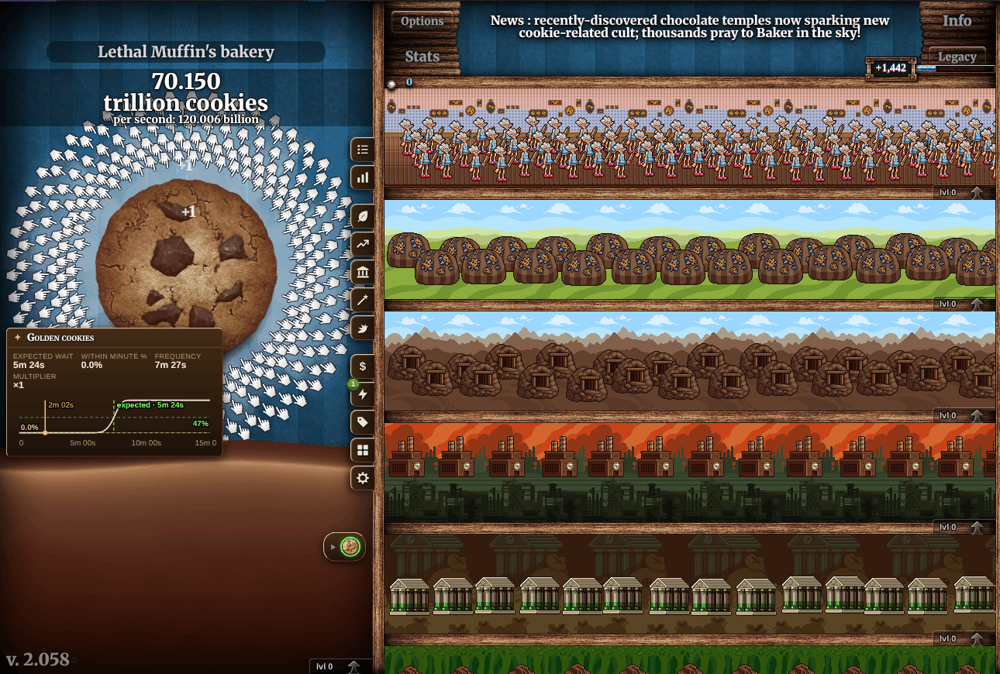

## Install

cookieMgr runs in the browser version of the game at
[orteil.dashnet.org/cookieclicker](https://orteil.dashnet.org/cookieclicker/). Pick one of these three ways.

### 1. Bookmarklet (recommended)

1. Make a new bookmark in your browser (right-click the bookmarks bar → **Add page…** / **Add bookmark…**).
2. Name it `cookieMgr`, and paste this whole line as its **URL**:

   ```text
   javascript:(function(){Game.LoadMod('https://nunorgcarvalho.github.io/cookieMgr/dist/CookieMgr.js?v='+Date.now());}());
   ```

3. Open the game, wait for it to finish loading, and click the bookmark.

A column of small icons appears next to the big cookie. That's cookieMgr. Click the bookmark again each time you
open the game; it always loads the latest version.

### 2. Userscript (loads by itself every time)

1. Install a userscript manager such as [Tampermonkey](https://www.tampermonkey.net/) or
   [Violentmonkey](https://violentmonkey.github.io/).
2. Open [CookieMgr.user.js](https://github.com/nunorgcarvalho/cookieMgr/raw/main/CookieMgr.user.js) and click
   **Install** when your userscript manager asks.

From then on cookieMgr loads whenever you open the game.

### 3. Console (one time, nothing to save)

Open the game, press **F12** (**Cmd+Option+I** on a Mac) and pick the **Console** tab, then paste this line and press
**Enter**. (Chrome may ask you to type `allow pasting` first.)

```js
Game.LoadMod('https://nunorgcarvalho.github.io/cookieMgr/dist/CookieMgr.js?v=' + Date.now());
```

## What's in it

cookieMgr adds a column of icons next to the big cookie, one per page. Hover an icon for its name and click it to open
the page. [See every page with a screenshot](#pages).

| Page | What it's for |
| --- | --- |
| **Stats** | Charts and numbers: cookies per second, where your cookies come from, golden cookie odds, prestige |
| **Events** | A log of in-game events, like golden cookies, purchases, ascensions, etc. |
| **Payback** | What each building and upgrade is worth, and the Auto buyer that buys the best one |
| **Macros** | Automations: autoclickers, golden cookie popping, alerts, and your own scripts |
| **Statistics** | What the store's tooltips show, and statistics you write yourself |
| **Garden**, **Stock market**, **Grimoire**, **Pantheon**, **Dragon** | A page per minigame, each with its own automation |
| **Widgets** | Small panels you place on the game's left side |
| **Settings** | Number format, hotkeys, updates, and your history's export and import |

## Pages

<table>
<tr>
<td width="50%" valign="top">
<b>Stats</b><br>
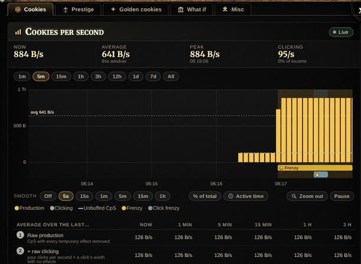
<ul><li>Cookies per second, where every cookie came from, your bank and prestige, charted and kept between sessions</li><li>Zoom and look back; Frenzy and other effects shaded behind the chart</li><li>Your income outside CpS, by source</li><li>Golden cookie odds, Lucky! banks, what-ifs for spirits and auras, what's left to collect</li></ul>
</td>
<td width="50%" valign="top">
<b>Events</b><br>
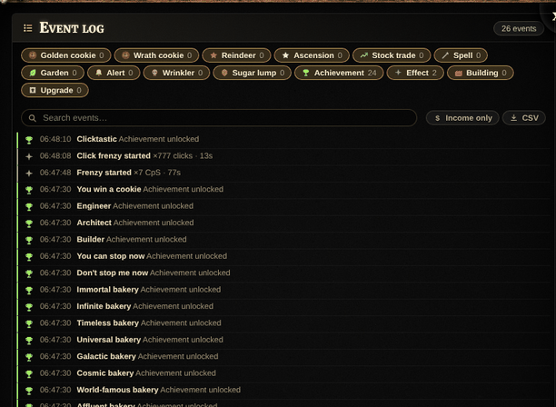
<ul><li>A log of golden cookies, wrinklers, sugar lumps, trades and ascensions</li><li>Filter, search and export it as CSV</li></ul>
</td>
</tr>
<tr>
<td width="50%" valign="top">
<b>Payback</b><br>
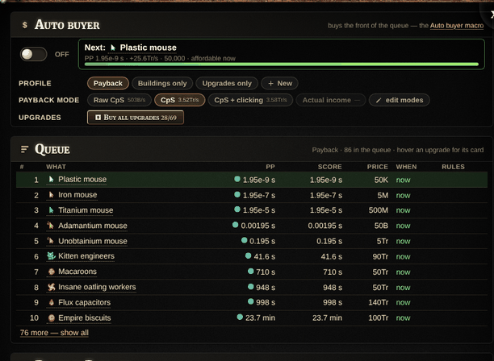
<ul><li>An exact payback period for every building and upgrade</li><li>The Auto buyer: a queue, profiles with rules, and a bank reserve</li><li>Buy all upgrades in one click, ranked in the queue by its own payback period</li></ul>
</td>
<td width="50%" valign="top">
<b>Macros</b><br>
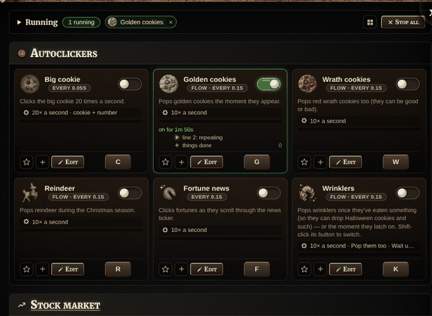
<ul><li>Autoclickers for the big cookie, golden and wrath cookies, reindeer, fortunes and wrinklers</li><li>Alerts, hotkeys and buttons on the left panel</li><li>Write your own macros in cookieMgr's simple code</li></ul>
</td>
</tr>
<tr>
<td width="50%" valign="top">
<b>Statistics</b><br>
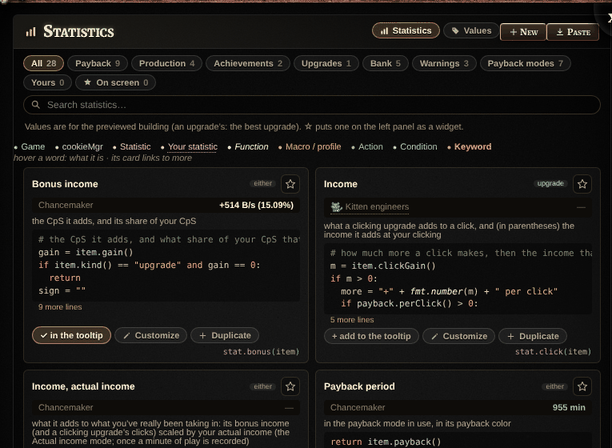
<ul><li>Choose the lines the store's tooltips show</li><li>Write your own statistics, with a live preview</li><li>Pick how payback is measured</li></ul>
</td>
<td width="50%" valign="top">
<b>Garden</b><br>
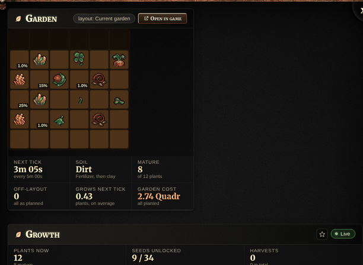
<ul><li>An Auto-gardener with layouts and profiles</li><li>Mutation odds on every empty tile</li><li>Growth charts and harvest counts</li></ul>
</td>
</tr>
<tr>
<td width="50%" valign="top">
<b>Stock market</b><br>
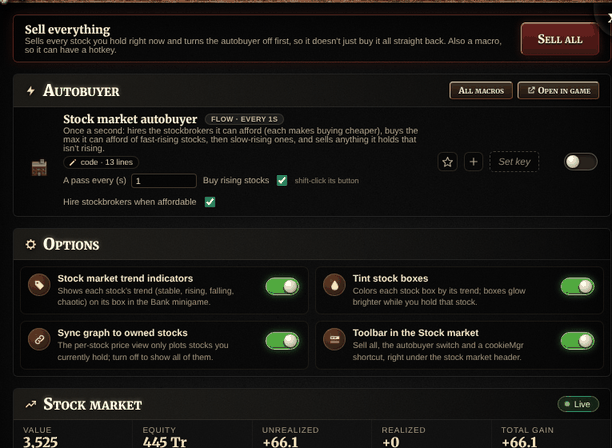
<ul><li>A stock autobuyer and Sell all</li><li>Trend badges on every stock in the Bank</li><li>Portfolio charts and your trade history</li></ul>
</td>
<td width="50%" valign="top">
<b>Grimoire</b><br>
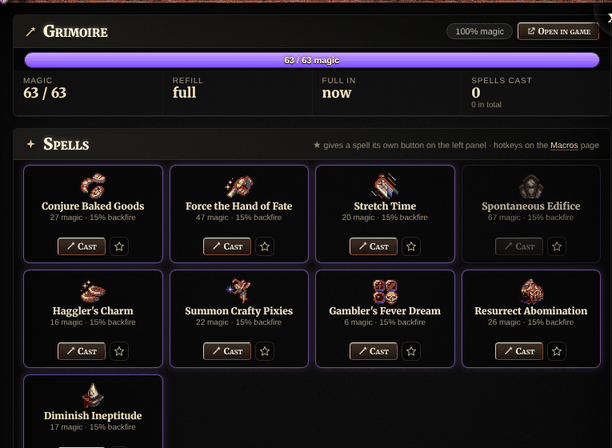
<ul><li>Magic, refill and every spell's cost at a glance</li><li>Cast from a button or a hotkey</li><li>Auto-cast Force the Hand of Fate when the combo is right</li></ul>
</td>
</tr>
<tr>
<td width="50%" valign="top">
<b>Pantheon</b><br>
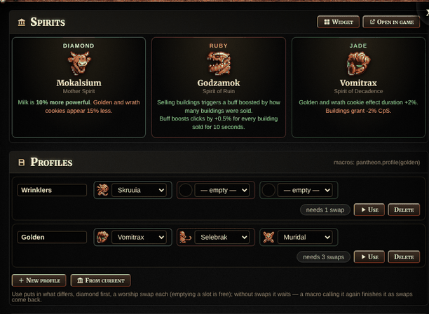
<ul><li>Your slotted spirits and what each does</li><li>Profiles that swap spirits for you</li></ul>
</td>
<td width="50%" valign="top">
<b>Dragon</b><br>
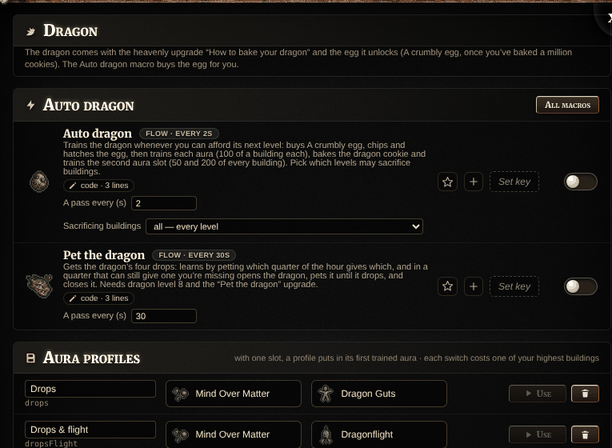
<ul><li>Auto dragon trains it as you can afford</li><li>Pet the dragon for its drops</li><li>Aura profiles</li></ul>
</td>
</tr>
<tr>
<td width="50%" valign="top">
<b>Widgets</b><br>
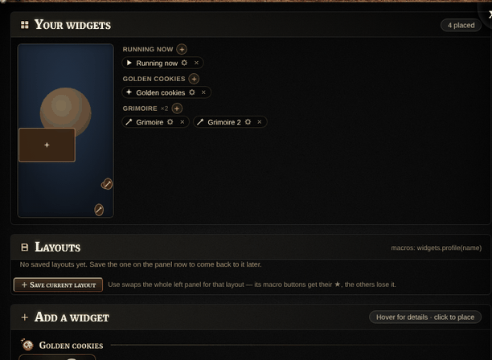
<ul><li>Place macro buttons, golden cookie odds, effect timers, charts and more on the left panel</li><li>Save and switch layouts</li></ul>
</td>
<td width="50%" valign="top">
<b>Settings</b><br>
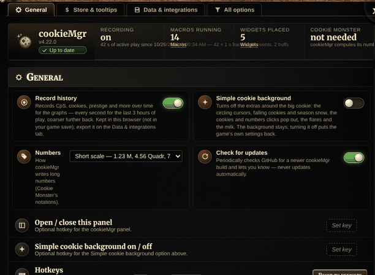
<ul><li>Number format, hotkeys and update checks</li><li>Export and import your history</li><li>Load Cookie Monster alongside</li></ul>
</td>
</tr>
</table>

**Coming in v4.0.0:** managers that play a whole ascension for you in stages, switching macros and profiles as the
run goes on.

## Additional information

- **Does not use in-game seed.** cookieMgr never reads the game's random seed to predict what comes next. It works
  from expected values and your own history only.
- **Data is stored locally.** Settings are saved inside your Cookie Clicker save (so they survive export and import),
  and the recorded history stays in your browser.
- **Turning it off.** Reload the game page without clicking the bookmark.

## Learn more

- **[The full guide](docs/GUIDE.md)**: every page, option and macro word in detail.
- **[Changelog](CHANGELOG.md)**: what changed in each version.
- **[Developing cookieMgr](docs/DEVELOPMENT.md)**: building, testing, the project layout and how to add things.
- **[The simulator](sim/README.md)**: run Cookie Clicker headless to test strategies over weeks of game time.

## License

[MIT](LICENSE)
