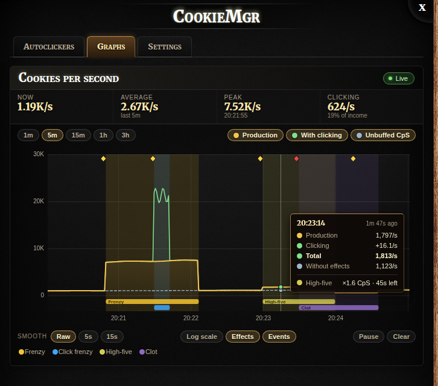
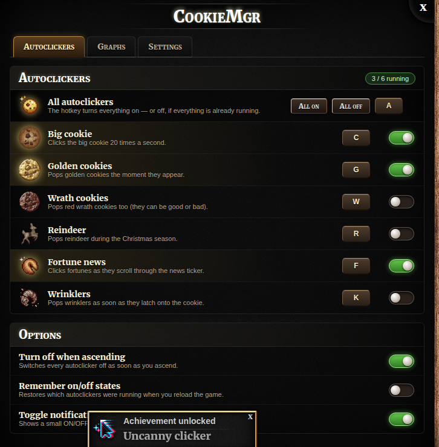

# cookieMgr: the full guide

Everything cookieMgr does, page by page. New here? Start with the [README](../README.md): it has the install steps and a
short tour. This guide is the reference for when you want the details.
## Terminology

The same words mean the same things everywhere in the add-on and this README:

| Term       | Meaning                                                                                 |
| ---------- | --------------------------------------------------------------------------------------- |
| **Page**   | A top-level section of cookieMgr, one per icon in the sidebar (e.g. Graphs).            |
| **Tab**    | A sub-section inside a page.                                                            |
| **Action**    | One thing cookieMgr can do in the game, once (click the big cookie, pop golden cookies, …). |
| **Macro**     | An automation made of one or more actions: on a repeat, when a condition holds, or once. |
| **Condition** | Something a macro can wait for (an effect is active, a value crosses a line, …).       |
| **Hotkey**    | A key combination bound to one or more macros. hotkey → macro(s) → action(s).          |
| **Event**  | Something that happened in the game (a golden cookie popped, a stock was sold, …).      |
| **State**  | A value that can be measured over time (cookies in the bank, CpS, …).                   |
| **Frame**  | One recorded sample of every state at a moment (or, for older history, a merged span).   |
| **Widget** | Something on the game's left panel: a macro's button, the Running now bar, quick stats, events, minigames. |

## The sidebar and its pages

A column of small icons sticks out of the left beam just below the game's cookie counter, one per page:
the data pages **Events** and **Stats**; the minigames **Garden**, **Stock market**, **Pantheon** and **Grimoire**, and the **Dragon**;
then **Payback** (the Auto buyer's hub), **Macros**, **Widgets** and **Settings** — a small gap between each kind. Hovering an icon slides its name out to
the left. Wherever a page mentions another (a Macros section, a "Macros page" hint), the name is a link to it, and
each minigame page has an **Open in game** button that closes the panel and takes you to the minigame.
Clicking one opens the cookieMgr panel straight to that page (switching pages directly if it's already open on a
different one); clicking the page that's already showing closes the panel.



### Stats

The Stats page (until v3.47.0 two pages, Graphs and Stats) has five tabs. **Cookies** and **Prestige** hold charts drawn from the recorded history
(see below; Prestige also has the prestige statistics and a target), so they survive refreshes and browser restarts. Every chart works the same way:

- **Window:** 1m, 5m, 15m, 1h, 3h, 12h, 1d, 7d or All. Older history is coarser (see Recorded history), and bars simply
  get wider where it is.
- **Active time:** leaves out time the game wasn't running (tab closed, computer asleep, background throttling) — a 1h
  window then covers an hour of actual play. A faint dotted line marks each cut-out stretch (the hover readout says how long);
  axis labels still show the wall-clock time. One toggle for all charts, also in Settings.
- **Smooth:** Off, 5s, 15s, 1m, 5m, 15m or 1h — a centered moving average: each point becomes the average of the
  stretch of time around it (weighted by time, so a smoothed rate is exactly the cookies over that stretch ÷ its
  length). Bars stay as narrow as the screen allows instead of getting wider. Running totals aren't smoothed.
- **Log scale** on line charts (prestige, stock prices, magic) fits the axis to the data — from just under the
  smallest value to just over the largest, with round ticks. Points covering mostly time the game wasn't running don't
  count; they're trimmed at the bottom.
- **% of total** on stacked bar charts: each bar becomes the shares of its total instead of amounts.
- **Axes always fit what's shown:** hiding something (gains, losses, a line) rescales the chart right away.
- **Zoom:** drag across a chart to zoom into that stretch of its x axis (a band shows what you're picking; Esc lets
  go). Zooms stack: **Zoom out** or a double-click steps back, and picking a window clears it. A stretch that reaches
  now keeps following now. It works on every chart, the garden's "garden ticks" axis included.
- **Scrollable:** shift-drag (or scroll sideways) to look back; **Pause** / **Jump to live**. Every choice is remembered.
- **Effect shading** behind the chart for every golden-cookie effect (Frenzy, Click frenzy, Elder frenzy, Dragonflight,
  Clot, …), stacked in lanes (each with the effect's own icon) when they overlap, and **event markers** for golden/wrath cookies, reindeer, stock trades
  and ascensions.
- **One hover readout** that follows the x axis: the time; every effect active there, each with what it multiplies,
  and — two or more — all of them combined (the overall boost to CpS and clicks); then the bar's figures. Over an
  effect lane (highlighted) or an event marker its details are added as a section of the same box, and a stretch the
  game was off within that bar is a one-line note.

**Cookies tab**

- **Cookies per second** — stacked bars of Production (the game's CpS) with Clicking on top, a dashed Unbuffed CpS
  line, and an average line. Below it, a table of **three stages**, each building on the last — **1 raw production**
  (CpS with every temporary effect removed), **2 + raw clicking** (clicking with click effects like Click frenzy
  divided back out — measured as your clicks per second × what one click is worth with no effects at all, using the
  game's own click formula with unbuffed CpS), **3 actual** (everything really baked: effects, golden cookies,
  wrinklers…) — and the
  multipliers between them: what clicking adds (2 ÷ 1), what effects & golden cookies add (3 ÷ 2), and the total
  (3 ÷ 1). Now and averaged over the last 1, 5, 15 minutes, 1 and 3 hours of active play.
- **Actual CpS** — everything that moved the bank each second, in categories you pick with chips: **building CpS**,
  **clicking**, **drops** (Lucky!, chains, storms, reindeer… and wrath losses), **stock trades** (bought / sold),
  **buildings** (bought / sold), **upgrades**, **other** (wrinklers, sugar lumps, spells, Santa, the dragon… —
  whatever's left, so these always add up to exactly what the bank did), and **stock equity** (off by default; see
  below). **▲ Gains / ▼ Losses** choose money in (above the line) and out (below it). **✦ CpS-boosted** shows, for
  building CpS, clicking and drops, the extra that CpS effects (Frenzy, Click frenzy…) add on top of their unboosted
  part, in a lighter shade — for drops, the share of the payout a CpS effect caused (none when Lucky! hit its
  bank-based cap). Window, smoothing, % of total, effect lanes with icons, and a dashed line for the CpS the game
  shows. Below it, a table with one row per category, figures side by side — "(raw / boosted)", "(−bought / +sold)",
  "(raw)"… — now and averaged over the last 1 min – 3 h, then In / Out / Net.
- **Stock equity** — what your stocks would sell for right now, in cookies (the same figure as the Sell all preview).
  As a category it shows equity going up and down: at a purchase it rises by about what the bank paid (minus the
  broker's cut), at a sale it falls by exactly what the bank received, and in between it moves with the prices. It
  sits outside the bank, so with it on the Cookie bank chart becomes bank + stocks.
- **Cookie bank** — the same, added up from the start of this session or the window: how the bank got where it is.
  It shares every setting with Actual CpS (chips on either chart change both). With all categories, gains and
  losses on, the added-up chart traces the real bank exactly (dashed line).

**Prestige tab** — a **prestige target**: type a number (1–999) and pick a magnitude (thousand, million, …) to see
levels and cookies to go, when you'll get there at your actual CpS over the Prestige chart's window (its 15m … All
chips), and a progress bar for this run (the
target is also drawn on the chart when it's in reach). Then prestige level if you ascended now against your current
level, with how many cookies the next level needs; and **prestige gained per hour**.

### Events

Everything that happens lands in one **event log**: golden and wrath cookies (with what they did), reindeer,
wrinklers popped (with what they gave back — shiny ones too), sugar lumps harvested, achievements unlocked,
golden-cookie effects starting, stock trades and ascensions. The Events page shows it:

- **Event log** — newest first (a golden cookie that granted an effect instead of cookies shows the CpS it added), with a chip per event type to show or hide it (with counts), an **Income only**
  filter, a search box, and a **CSV** download of whatever is shown.

The Stats page's **Cookies** tab adds it up below its charts:

- **Income outside CpS** — a live table of every source of cookies other than production and clicking, for this
  session, the last 15m / 1h / 1d, or everything: golden cookies, wrath cookies, reindeer, wrinklers, sugar lumps,
  stock trades (net), golden-effect boosts (the extra production from Frenzy & co.) and anything else — with counts,
  cookies, average per event, share of all cookies baked, and when it last happened.

Wrinkler payouts are worked out the way the game does it (what the wrinkler ate × 1.1, with Sacrilegious corruption,
Dragon Guts, shiny ×3, Wrinklerspawn and Scorn), since the game pays them out with nothing for an add-on to hook.

### Recorded history

cookieMgr records a set of **states** every second while you play: CpS (total, unbuffed, clicking), cookies in the
bank, cookies baked (this ascension and all time), where each second's cookies came from (production, clicking,
golden cookies & reindeer, other), what left the bank (spending, wrinklers), prestige, every stock price and your
portfolio's value / cost basis / realized profit, and Grimoire magic. Alongside it, an **event log** keeps golden and
wrath cookies, reindeer, ascensions and stock trades.

- **Kept out of the game save.** All of it lives in the browser's IndexedDB, per save (two bakeries in one browser
  don't mix), never in localStorage — the game's own save lives there and the game silently ignores running out of
  room (the 1.2.2 bug). Nothing cookieMgr records can stop the game from saving.
- **Active play time only.** Time only counts while the game is actually running; a closed tab or sleeping computer
  doesn't leave hours of empty space or get lumped into one second.
- **Progressively coarser with age:** every second for the last 3 hours of active play, every 15 s up to 24 hours,
  every 2 minutes up to a week, then every 15 minutes, kept indefinitely. Older data is merged sensibly — averages for
  rates, last value for totals, sums for "cookies earned this frame" — so totals stay exact.
- **Settings → History data:** see how much is recorded, **Export** it to a file, **Import** a file (replacing this
  save's history — handy for moving browsers), or **Clear** it. Import and Clear ask for a second click.

### Macros



Everything cookieMgr automates is a **macro**, and every macro is **algorithmic code** running on one engine — the
built-ins, the Auto-gardener, the stock autobuyer and your own. For the common shapes there are shortcuts that write
the code for you: one or more **actions** run in order, on a trigger —

- **Repeat** — while it's on, every so often (the autoclickers: every 0.05–0.1 s);
- **When…** — while it's on, it watches a **condition** and runs when it happens (or on every check while it holds);
- **Once** — no on/off: its **Run** button or hotkey runs it one time.
- **Group** — a switch for several macros at once: on turns all its members on, off turns them all off (it shows as
  on while all of them are). Handy for your own set of autoclickers under one button or hotkey.

**Built-in macros** (can't be removed; **Edit** any of them — most are code you can read and change, and Revert to
default brings the original back):

| Macro                  | Default key | What it does                                                         |
| ---------------------- | ----------- | -------------------------------------------------------------------- |
| Big cookie             | `C`         | Clicks the big cookie 20×/second                                     |
| Golden cookies         | `G`         | Pops golden cookies (not wrath)                                      |
| Wrath cookies          | `W`         | Pops wrath cookies                                                   |
| Reindeer               | `R`         | Pops reindeer                                                        |
| Fortune news           | `F`         | Clicks fortunes in the news ticker                                   |
| Wrinklers              | `K`         | Pops wrinklers as soon as they attach                                |
| Stock market autobuyer | —           | Hires brokers, buys fast/slow-rising stocks, sells the rest, every second |
| Sell all stocks        | —           | Once: autobuyer off, then sells every stock                          |
| Cast … (one per spell) | —           | Once: casts that Grimoire spell                                      |
| SeasonCompletion       | —           | An algorithmic macro: research, then every season until complete      |
| Sugar lump harvester   | —           | Harvests your lump when ripe — or when mature, if you pick that      |
| Elder Pledge           | —           | Buys the Elder Pledge whenever the Grandmapocalypse is on            |
| FtHoF on combos        | —           | An algorithmic macro: Force the Hand of Fate when two effects line up |
| Auto buyer             | —           | Buys the front of the queue its profile ranks (Payback page)         |
| Research               | —           | Buys research as it comes (stops before One mind by default)         |
| Cheap upgrades         | —           | Buys upgrades costing under 1s (adjustable) of production            |
| Pet the dragon         | —           | Gets the dragon's four drops, learning by petting which quarter-hour gives which |

The autobuyer is the same switch as on the Stock market page and in the Bank minigame toolbar. (A group macro is
the way to switch several at once.)

Every built-in that makes a decision is **code over building blocks** (below): Golden cookies, Wrath cookies,
Reindeer, Wrinklers, the Sugar lump harvester, the Stock market autobuyer, the Auto buyer, Research, Cheap
upgrades, Pet the dragon, FtHoF on combos, SeasonCompletion and the Auto-gardener (whose code is the gardener you
pick, with its soil rule, template and seeds as inputs beside it). The Big cookie, Fortune news, Elder Pledge, Sell all and the spell casts have nothing to decide and
stay shortcuts. A built-in's **inputs** — the choices on its card (the Wrinklers' "shiny" and "fed", the autobuyer's
"buy" and "brokers", …) — are variables in its code; shift-click flips one, and changing one
while it runs applies on its next pass. Each was checked against the JavaScript it replaced, on random states: the
same things popped, bought and traded.

Every built-in has **settings**: the line under its description sums them up — click it to change them. How often it
runs (a number: times a second for the fast ones — the big cookie up to 50, the most the game counts — or every so
many seconds), and every choice its actions have: how the **Big cookie**'s clicks look (the
falling cookie and the "+N" number, the cookie only, or nothing — your own clicks are left as the game has them),
whether **Wrinklers** waits until a wrinkler has eaten before popping it (only then can it drop Halloween cookies
and such — **shift-click** its button to pop them at once) and spares shiny ones, whether the **Stock market autobuyer** may buy (off: it only sells what you
hold when it stops rising — **shift-click** its button on the left panel to switch), and when the **Sugar lump
harvester** picks: **ripe** (always pays) or
**mature** (about 3 hours sooner, but with the game's 50% chance of getting nothing).

**SeasonCompletion** is an **algorithmic macro** (below) — its code is yours to change ("Edit" on its card;
"Revert to default" brings the original back). Switched on, it buys the Bingo center's research right away (which
starts the Grandmapocalypse — Halloween's cookies come from wrinklers), and alongside goes through the seasons:
Christmas first for Santa's upgrades and Santa all the way to Final Claus, then Easter, Halloween and Valentine's day
each until every one of its cookies is owned (switching on what collects them: golden and wrath cookies for Easter,
wrinklers for Halloween), then Christmas again for its reindeer cookies — leaving the Grandmapocalypse there, as
those don't need wrinklers — and finally Business day for good, keeping the elders pledged. Its card shows the line it's on with the counts it's checking ("owned(christmas, upgrades) = 12 ≥
total(christmas, upgrades) = 15 ✗") and the if / elif decisions it took.

**Every built-in can be edited** like your own macros: **Edit** on its card opens the full editor (its steps, kind,
code…); your version replaces it, its card says "edited", and **Revert to default** (in the editor) brings back the
original — so do changed settings.

**Your macros** — **New macro** opens the editor: a header with the icon, name and description (Save, Cancel,
Delete), the kind of macro as cards — **Repeat**, **When…**, **Once**, **Group**, **Algorithmic** — how often it runs,
then what it does: numbered step cards (an action each, with its options; ▲ ▼ × to move or remove), a "When…"
macro's conditions, a group's members, or an algorithm's code. Beside it, always, the **library**: every action,
condition, value and keyword, searchable — click one to insert it (into the code where the cursor is, or as a new
step), ★ to pin it at the top. Its **Lookup** tab lists the names that go inside the parentheses — spells, effects,
macros, seasons, buildings, soils… — each with where it's used; click one to write it where the cursor is.

**Hover any word of code** — in a macro, a statistic, the gardener's rules, or a statistic's code on the Statistics
page — and a card says what it is: an action or condition (what it does with the options written there), a value
(and what it is now), a keyword, a variable (where it's set), a macro (`switch on golden`: its name, what it does,
whether it's on), or a profile (`buyer.profile(payback)`, `dragon.profile(drops)`, `pantheon.profile(golden)`,
`grimoire.profile(default)`: what's in it and whether it's in use), a spell, a spirit, an aura, a season, a
building or an upgrade (its info card). Move onto the card to use its link: to the macro's editor, the profile's
page, the statistic's editor, or the line a variable is set on. Unsaved code is asked about first (Save and go, Don't
save, Stay), and a **Back to …** chip at the bottom of the panel returns to the code you left.

**Every macro is algorithmic code underneath.** Repeat, When… and Once are shortcuts for the common shapes, and the
editor shows what one amounts to under **As code**:

```
forever:                          # Repeat: its steps, every pass
  pop.golden()

forever:                          # When… "once each time it happens"
  wait until buff(Frenzy)
  pop.golden()
  wait until not buff(Frenzy)

forever:                          # When… "on every check while it holds"
  if buff(Frenzy):
    pop.golden()
```

**Carry on as code** turns it into an Algorithmic macro from there (so does picking the Algorithmic card). Groups are
the one kind that isn't code: they switch their members.

**Algorithmic macros** are written like pseudo-code, indented like Python:

```
# research alongside, seasons one by one
parallel:
  branch research:
    repeat until researchOwned() >= 9:
      buy.research(none)
  branch seasons:
    for season in [easter, halloween]:
      if season == halloween:
        switch on wrinklers
      repeat until owned(season, all) >= total(season, all):
        season.keep(season)
        season.buyDrops(season, all)
    wait until cookies() >= 1e15
    stop
```

Lines: an action with its options (`pop.golden()`, `season.keep(christmas)` or `season.keep(season=christmas)`),
`switch on / off <macro>`, `wait until …`, `wait 30 seconds`, `repeat until …:`, `while …:`, `repeat 5 times:`,
`forever:`, `if …: / elif …: / else:`, `for x in [a, b]:`, `parallel:` with `branch:` blocks, `stop`, `log "…"` and
`# comments`. Conditions join with `and` / `or` / `not` and brackets, and compare **values** — `cookies()`, `cps()`,
`magic()`, `owned(season, part)`, `total(season, part)`, `santaLevel()`, `building(Farm)`, `state(…)` and more —
with `>= <= > < == !=`; numbers can be written 1e12, 25K, 2.5M, 3B.

Values add up: `+ - * / %` and brackets (`cookies() > 0.1 * cps() * 60`, `(a + b) / 2`). **Variables** remember a
number, text or a condition's yes / no — `target = cookies() * 0.1`, `ready = buff(Frenzy) and magic() > 50` — and a
variable (or a yes / no value like `garden.isMature(tile)`) can be a condition on its own: `if ready:`. **Live lists**
loop over what's there now: `for good in stocks():`, `for tile in garden.tiles():` — as many items as finish in one
pass (a body that waits picks up from that item on the next). Options can be anything you can compute:
`stock.buy(good, 10)`, `garden.plant(tile, garden.wantAt(tile))`. **Named blocks** keep long code readable:

```
def sellIfFalling(good):
  if stock.held(good) > 0 and stock.mode(good) == 4:
    stock.sell(good)

forever:
  for good in stocks():
    sellIfFalling(good)
```

`log <a value>` writes it to the macro's trace (`log stock.price(CRL)`).

**Building blocks** — the game, piece by piece, for your own code (every one is in the library, with its Lookup):

- **Stock market** — `stocks()` (a list), `stock.mode / price / resting / held / max / room / delta / cost(good)`,
  `stock.brokers()`, `stock.maxBrokers()`, `stock.brokerPrice()`; `stock.buy(good, n)`, `stock.sell(good, n)`,
  `stocks.hireBrokers()`. A stock is its symbol (CRL), its building (Farm) or its number; modes: 0 stable, 1 slow rise,
  2 slow fall, 3 fast rise, 4 fast fall, 5 chaotic.
- **Golden cookies and the bank** — `bank.lucky()`, `bank.luckyFrenzy()`, `bank.conjure()`, `bank.chain()`,
  `bank.chainFrenzy()`, `bank.edifice()`, `bank.plant(plant)` (the bank each needs to pay its most);
  `reward.lucky()`, `reward.luckyFrenzy()`, `reward.chain()`, `reward.conjure()`; `golden.soonest / latest /
  expected()` (seconds), `golden.chanceWithin(seconds)` (0–1), `reindeer.expected()`.
- **Prestige** — `prestige.ifAscended()`, `prestige.toNext()` (cookies), `prestige.perSecond()`, `prestige.cpsGain()`,
  `prestige.cookiesFor(level)`, `prestige.secondsTo(level)`, `prestige.nextIn()`.
- **Wrinklers** — `wrinkler.reward(w)`, `wrinklers.reward()`, `wrinklers.rewardFattest()`, `wrinklers.eating()`.
- **Timers, what's left, what if** — `buff.timeLeft(effect)`, `buff.goldenChance(effect)` (a golden cookie before it ends, 0–1), `buff.effectiveMult(effect)` (what it multiplies your income by, clicking counted at your click rate), `golden.effectDuration(effect)` (seconds an effect lasts if it starts now, with your upgrades), `lump.ripeIn()`, `autosave.in()`, `magic.fullIn()`;
  `missing.upgrades()`, `missing.achievements()`, `missing.seasonDrops(season)`, `missing.plantDrops()`;
  `pantheon.cpsGain(god, slot)`, `dragon.auraCpsGain(aura, slot)`.
- **Garden** — `garden.tiles()` (tiles are `"x,y"`), `garden.plantAt / wantAt / age / decay(tile)`,
  `garden.isMature / isNew / isEmpty / isOff(tile)`, `garden.seeds()`, `garden.seedCost(seed)`; `garden.harvest(tile)`,
  `garden.plant(tile, seed)` — and the whole-plot ones the default rules use (`garden.plantEmpty()`…);
  `garden.mutationChance(x, y)`, `garden.growChance(seed)` (at the next tick, 0–1), `garden.growIn(seed)` (seconds).
- **Minigames** — `spell.cost / waitFor / recover / failChance(spell)`, `fthof.backfireChance()`,
  `stock.restingRatio(good)`.
- **Shimmers & wrinklers** — `shimmers()`, `shimmer.type / isWrath / life(s)`, `shimmer.pop(s)`; `wrinklers()`,
  `wrinkler.isShiny / isFed / sucked(w)`, `wrinkler.pop(w)`.
- **Sugar lump** — `lump.isRipe()`, `lump.isMature()`, `lump.pick()`.
- **Buying** — `pp.best(kind, skip)` (the lowest payback period of building / upgrade / all), `pp.kind / price /
  of(thing)`, `pp.buy(thing)` (before v3.5 these were `cm.best`, `cm.kind`, `cm.price`, `cm.pp`, `cm.buy` — code using
  those names still works); `best(kind)`, `buy.best(kind)`; `building.price / gain / payback(building)` and, for n at
  once, `building.priceOf / gainOf / paybackOf(building, n)`; `building.toNextAchievement(building)`;
  `upgrade.gain / payback(u)` (NaN for a switch); `building.paybackIn(building, mode)`, `upgrade.paybackIn(u, mode)`,
  `payback.mode()`, `payback.modes()`, `payback.income(mode)`, `payback.bank()`, `payback.clickRate()`,
  `payback.perClick()`, `payback.actualIncome()`, `payback.actualRatio()`; `paybackActual(seconds)`, `actualIncome(seconds)`;
  `timeTo(price)`, `clickRate()`; `building.buy / sell(building, n)`; `upgrades()`,
  `upgrade.price(u)`, `upgrade.owned(name)`, `buy.upgrade(u)`; `research.next(stopBefore)`.
- **The dragon** — `dragon.canPet()`, `dragon.dropNow()`, `dragon.pet()`; `dragon.level()`, `dragon.aura(slot)` (1 or 2),
  `dragon.canTrain(buildings)`, `dragon.train(buildings)` (buildings: all, one or none — which levels may sacrifice
  buildings), `dragon.setAura(aura, slot)`; aura profiles: `dragon.profile(profile)` (its id or name),
  `dragon.profileActive(profile)`, `dragon.activeProfile()`, `dragon.profiles()`.
- **Pantheon** — `pantheon.gods()`, `pantheon.god(slot)`, `pantheon.slotOf(god)`, `pantheon.isSlotted(god)`,
  `pantheon.swaps()`; `pantheon.slot(god, slot)` (diamond, ruby, jade, or none).
- **Widget layouts** — `widgets.profile(name)` (a saved layout from the Widgets page, its id or name),
  `widgets.profileActive(name)`, `widgets.activeProfile()`, `widgets.profiles()`.
- **Macros** — `macro.isOn(id)`, `switch on / off …`. The editor colors the code, numbers the lines,
lists any problems as you type (click one to jump to it), indents for you (Tab, and Enter after a `:`), and while
the macro runs lights up the lines it's on and shows what it's checking. Every pass (its interval) moves each branch
on as far as it can without waiting; reaching the end (or `stop`) switches it off. Actions:
click the big cookie, pop golden / wrath cookies, reindeer, wrinklers (optionally sparing shiny ones), click fortune
news, trade stocks, sell all stocks, harvest the sugar lump (once ripe, or once mature), keep a season going, buy a season's drops, upgrade Santa,
leave the Grandmapocalypse, the buying actions, pet the dragon, cast a spell, switch another macro
on/off/toggle, run another macro. Conditions: an effect is active (Frenzy, Click frenzy, …), any building special,
several effects at once, something to pop is on screen, enough magic for a spell, magic at a % of the maximum, or any
recorded value (CpS, cookies in bank, prestige, a stock price…) above or below a number, a season being on or
complete, all research bought, the Grandmapocalypse being on — each can be negated, and
**And…** adds more conditions that must all hold. Your macros are saved with your settings inside the game save.

**Buying.** The **Auto buyer** buys the front of a **queue**: its active profile (on the [Payback](#payback) page)
ranks every building and upgrade by payback period (PP: time to afford it + price ÷ what it adds — see [Payback
periods](#payback-periods)), then by the profile's rules, into one list. Buildings come in the profile's bulk — auto is
the store's **Minimum bulk** (Settings → Store, the store toolbar, or the Payback page): ×1, ×10 or ×100 at a time — up
to the next multiple of it when Round to multiples is on (37 owned, ×10: 3, to 40) — ranked by the PP of exactly that
many; auto (the default) is ×10 with Round to multiples on, else ×1. Switches (Elder Pledge, the Golden switch, season
biscuits…) have no payback period: they're never ranked and never bought. Upgrades that only make clicks stronger are
judged by what they add per click × your clicks per second. A profile saves up for the front, or skips to what you
can afford, and can keep a bank reserve. (It replaced Best building and Best upgrade in v3.44; old saves move over.)
**Hold** a
buying macro's button (instead of clicking it) and it buys again and again, fast, until you let go. Their buttons
are tinted muted green or red for whether the next purchase is affordable now (hover for what and when), and
switching one on when it can't buy yet shakes it and says why. **Research** buys the Bingo center's research as it appears,
stopping before the one you pick (One mind by default — it starts the Grandmapocalypse). **Cheap upgrades** buys any
upgrade costing less than a second (adjustable) of your unbuffed production.

#### Payback periods

cookieMgr works payback periods out itself — the numbers Cookie Monster shows, without Cookie Monster. What a
purchase adds is asked of the game: cookieMgr makes the change (one more building, ten, a hundred, an upgrade
bought), runs the game's own CpS calculation, reads the result and undoes it — so the numbers are exact for any game
version, and it counts the achievements the purchase would win (their milk makes kittens stronger), as Cookie Monster
does. The payback period is Cookie Monster's: **time until you can afford it + price ÷ the CpS it adds**. Colors
follow Cookie Monster's too: blue (better than the best building), green (the best building), yellow / orange / red
(within the 10 / 20 / 30 best building payback periods, counting ×1, ×10 and ×100), purple (worse), gray (never pays
back). It's checked against Cookie Monster itself in the real game (the simulator's parity test): every building at
×1, ×10 and ×100 and every upgrade in the store, the same to the last digit.

Payback periods read in time units: seconds, then minutes, hours, days and years, the next unit only once the
number passes 999 (999 s, then 16.7 min), so they keep three digits. **Payback periods in** (the Payback page's
Options) switches them back to plain seconds, Cookie Monster's way (999, 1K).

**Pet the dragon** gets the dragon's four drops (Dragon scale, claw, fang, teddy bear): each pet has a 1 in 20 chance,
and which one drops depends only on the quarter of the hour, in an order fixed per run. It learns that order by petting
(it never reads your save's seed): in a quarter it hasn't tried, or whose drop you're still missing, it opens the dragon,
pets it until something drops (200 pets with nothing: that quarter's drop is one you have), and closes it again; its
button says what this quarter-hour gives, as far as it knows, and when the next quarter worth trying comes. Needs dragon level 8 and the "Pet the dragon" upgrade.

**Running** at the top of the page is a strip with a chip per running macro (warmer the busier it is — click one to
find its card, × to stop it) and **Stop all**. A running macro's card shows, for each of its actions, how many things
it has done and when it last did something (or that it can't run right now).

**Hotkeys** — every macro can have one; one key can trigger several macros at once (binding a key that's in use shares
it). Modifiers work (`Shift + G`): click a key chip and press the new key (`Esc` cancels, `Backspace` clears).

**Favorites** — the ★ on a macro gives it its own button on the left panel (see Widgets).

### Payback

The **Payback** page sits right above Macros and is the hub of the **Auto buyer**. At the top: its switch, what it
buys next (a bar filling as you save for it), the **profiles** (click one to make it active; **New** copies it), the
payback mode, and **Buy all upgrades** (the game's Inspired checklist button, without needing it: every upgrade you
can afford but switches, research and what you've vaulted, cheapest first), with its own payback period beside it.
Then the **Queue**: place, what (an
upgrade with its icon and its info card on hover), payback period in its color, score (the payback period after the
rules' weights — the order), price, when you can afford it, the rules that touched it; what's held back below,
grayed, with why. **Buy all upgrades** is a row of its own: the upgrades the budget affords, bought at once and
measured together (so upgrades that multiply each other count as one purchase). Profiles that buy upgrades come with
the rule *Buy all upgrades → buy first when `payback.allUpgradesCount(buyer.budget()) >= 20`*: with lots affordable,
it takes them all at once. Then the active **Profile**: what it buys (buildings, upgrades, Buy all upgrades), the building bulk, save up or skip,
the bank reserve (minutes of unbuffed CpS, plus any of the **Lucky!**, **Conjure**, **Frenzy Lucky!** and **Garden
replant** banks — it keeps the highest, so the bank never drops below any of them), what it ranks by (a payback mode), and its **rules**, top to bottom: what
they apply to (anything, buildings, upgrades, Buy all upgrades, one building or upgrade, cookies, kittens, synergies, clicking upgrades,
anything under N s of CpS, anything that wins an achievement) → **buy first**, **weight ×k**, **up to N owned** or
**never**, each with an optional **when** in the macro language (`thing` is what's ranked). In code: `buyer.next()`,
`buyer.queue()`, `buyer.rank(thing)`, `buyer.score(thing)`, `buyer.budget()`, `buyer.reserve()`, `buyer.profile(x)`, `buyer.buyNext()`,
`buy.allUpgrades()`; Buy all upgrades' payback period: `payback.allUpgrades()` (`payback.allUpgradesIn(mode)`,
`payback.allUpgradesGain()`, `payback.allUpgradesPrice()`, `payback.allUpgradesCount(budget)`), and in the queue it is
the thing `"allUpgrades"`.

Below it, what every purchase is worth (see [Payback periods](#payback-periods)): every
building with a cell for **×1**, **×10** and **×100** — colored by its payback color, with its payback period, the
CpS it adds and its price (hover for the achievements it would win; **click a cell to buy that many**) — and how many
more win its next achievement; the store's upgrades as tiles ringed in their color, best first (click to buy); and
its options: the minimum bulk, count your wrinklers in the bank (none, all, the fattest), "best = what you can
afford", and a "cheap enough to just buy" floor in seconds of CpS. Switches show among the upgrades only when their
filter chip is on, grayed.

**Payback mode** is the page's main setting, in the Auto buyer card: what payback periods count in. A payback period is
**max(price − bank, 0) ÷ income + price ÷ gain** — the time to afford it, plus the time to earn its price back — and
the mode says what the income is and what a purchase adds to it:

- **Raw CpS** — the game's raw CpS (no golden cookie effects, golden switch or Dragon's Fortune): steady, whatever is
  running now.
- **CpS** (the default) — the CpS the game shows now, buffs included: Cookie Monster's.
- **CpS + clicking** — CpS plus your clicks a second (over the last minute; Options: 10 s to 15 min) × what a click is
  worth; a purchase's gain counts what it adds to your clicks.
- **Actual income** — what you've actually been taking in (clicking, golden cookies, wrinklers, everything baked, as
  the Recorder measures it) over the last 30 minutes of play (Options: 5 minutes to 3 hours), projected forward; a
  purchase's gain is what it adds to your raw CpS × actual ÷ raw CpS. Until a minute is recorded, CpS.

The mode is the add-on's: the colors, the store's sort and tooltips, the best buy and the buyers all follow it. Each
chip shows that mode's income now; hover a cell for its period's parts ("5m to afford + 20m to earn back").

**Payback modes are statistics** (the Statistics page's Payback modes shelf — **edit modes** on the Payback page):
each one's code sets `income` and returns what the item adds to it. Change a built-in one, copy it, or write your own
(Shows as: a payback mode) and it's a chip here. The parts are words too: `item.timeToAfford(mode)`,
`item.earnBack(mode)`, `item.gainIn(mode)`, `item.paybackIn(mode)`, `item.rawGain()`, `payback.income(mode)`,
`payback.bank()` (mode: a mode's code name — `rawCps`, `cps`, `cpsClicking`, `actualIncome`, yours — or `raw`,
`clicking`, `actual`; none: the mode in use).

In the **store** itself (Settings → Store, each can be turned off): each building's price shows in its payback
color for what a click buys now (×1, ×10, ×100, or to the next multiple with Round to multiples on), each upgrade
has a colored dot in its corner, and under the game's own building and upgrade tooltips a cookieMgr block adds the
CpS it adds (and its share of your CpS), its payback period (and by actual income, once a minute of play is
recorded), when you can afford it (green now, red not yet), a building's share of your production, how many more win
its next achievement (in the payback color of buying that many) and the next upgrade more of it unlocks —
and, with **Warnings** on, a colored "!" on the item and a ⚠ line in its tooltip when a warning applies: by default,
when buying it would take your bank below what a Lucky! (in a Frenzy too) or Conjure Baked Goods needs to pay its
most. Warnings are statistics too (below): change a bank warning's `keep` (how many times that bank to keep), turn
one off, or write your own.

**Which lines that block shows, and in what order, is yours to choose** — on the **Settings** page, **Store & tooltips** tab (see
[Statistics](#statistics)): add a line (a built-in statistic, one of yours, or **any value word** that takes the building
or upgrade, or nothing: `building.toNextAchievement`, `clickRate`, `golden.expected`, `golden.interval`…), drag it into place, rename a
word's line and choose how its value reads, remove it; **Reset** goes back to Cookie Monster's layout. A line with
nothing to say (no wins, too little recorded) is left out; a word that doesn't fit the tooltip (one taking an upgrade,
in a building's) too. The Payback page keeps the block's two switches.

**Every line is a statistic**: a few lines of algorithmic code (the language of [Macros](#macros)) that only read the
game and end with `return` — in a tooltip, `item` is the building or upgrade hovered and the `item.*` words read it
(`item.price()`, `item.gain()`, `item.payback()`, `item.color()`, `item.bulk()`, `item.wins()`, `item.share()`,
`item.paybackOf(n)`…). The built-in lines are written that way; for example, *Affordable* is

```
s = timeTo(item.price())
if s <= 0:
  return "now"
if finite(s):
  return fmt.time(s)
return "not at this CpS"
```

A statistic may set `label` (its line's label), `note` (small print after the value) and `color` (a payback color,
or a list of them for a list of values); with no `return` it shows nothing. It can't act, wait or loop without end
(no actions, `wait`, `while`, `repeat until`, `forever`, `parallel`, `stop`) and stops after 5,000 steps. Every
statistic is also a value word — `stat.payback(Farm)`, `stat.next(item)` — that macros and other statistics can use.
Text words build what a line says: `fmt.number(x)`, `fmt.short(x)`, `fmt.time(s)`, `fmt.pct(x, 2)`, `fmt.fixed(x, 2)`;
`finite(x)` and `known(x)` are yes / no.

**A warning is a statistic that shows as a warning**: when it has something to show about an item, the item gets a
"!" in the store (in the color of the first warning that applies, in the order you chose) and a tag in its tooltip's
⚠ line with what it returned. The built-in *Lucky! bank* is

```
keep = 1   # times that bank
need = bank.lucky() * keep
after = cookies() - item.price()
if cookies() >= need and after < need:
  return "−" + fmt.number(need - after)
```

**Upgrades: best first** orders the store's upgrades by color, then payback period
(switches last). The store's **Best buy** sort ranks buildings by what a click buys — or the minimum bulk, if more.

### Statistics

The **Statistics** page (next to Macros; it was the Tooltips page until v3.43) is every statistic — the store
tooltip's lines, the warnings, the payback modes and yours. The store tooltip's layout is a card on the **Settings**
page (**Store & tooltips** tab):

- **In the store tooltip** (Settings): the block's lines in order, in fixed columns: the line, what it's about (a building, an
  upgrade, either, the game), **its value now** for the previewed building, how a value word reads, and ↑ ↓ ✕ — or drag
  a row. Beside it, two live previews drawn by the tooltip's own code: a building you pick, and the best upgrade. The
  block's switch (Payback in tooltips) is here too, and **Warnings**: a switch, and the warnings in use in order (each
  with its color and value now; ↑ ↓ ✕, add one, **Reset** to the three bank warnings).
- **Statistics**: a card per statistic — built-in and yours — with its value for the previewed building (an upgrade's:
  for the best upgrade), what it shows, its code (colored, as in the editor) and how to call it
  (`stat.payback(item)`). Filter by group (Payback, Production, Achievements, Upgrades, Bank), **Warnings**,
  **Payback modes**, **Yours** or **On screen**, and search labels, descriptions and code. A payback mode's card can
  make it **the payback mode** (see [Payback](#payback)). One click adds a statistic to the tooltip or takes it out (a
  warning: uses it or stops it); **Duplicate** makes
  a copy that's yours; yours can be deleted (its tooltip lines go too); ☆ puts it on the left panel as a widget.
  **New**, **Edit** (yours) and **Customize** (a built-in) open the editor; **Paste** adds one copied as text.
- **Values**: every word a statistic can read — the `item.*` words first, then statistics, text, and the game's —
  with its signature, what it is and its value now (for the previewed building).

**The statistic editor** opens in place of the catalog, the way the macro editor does, and shares its parts:

- the label and what it shows; its **code name** (`stat.<name>(item)` in macros and other statistics — from the label
  until you give it one, and kept when you rename it), what it's **about** (a building, an upgrade, either, the game),
  how its value **reads** (as it reads, a number, a time, a chance, a payback period, text), its **color** (the
  item's payback color, or none) and its **group**;
- the **code**, checked as a statistic as you type (no actions or waits; `item.*` only in one about an item), with
  the **library** beside it listing what a statistic can use (the item's words first) and **knobs** for its top-level
  `name = 0.5` lines;
- **what it shows**, now, about the best item or one you pick — exactly as its tooltip line would — and **what it
  did**: each line it ran and what came of it (`gain = 157.5`, `if: no`, `return "+157.5/s"`); click a line number
  to go to it.

**Save** (refused while the code has a problem), **Cancel**, **As text** (copies it — a few `# label: …` lines, then the
code — to share or keep; **Paste** on the page adds it back), **Delete** (yours), and for a built-in **Reset** (back
to the original: a built-in keeps its code name, what it's about and its group; its label, code, format and color are
yours to change).

A **Statistic widget** (on the **Data** shelf of Add a widget, beside Quick stats and Latest events) shows one statistic live, as its tooltip line
would: about **the best** (the best building, the best upgrade or the best buy, as the statistic is about), or a
building or store upgrade you pick in its settings. Add as many as you like.

### Stats: Golden cookies, What if, Misc

The **Stats** page's statistics tabs are Cookie Monster's statistics, cookieMgr's way — every figure from the game's own formulas, and
checked against Cookie Monster in the real game. **Golden cookies** has the Next golden cookie (and
reindeer), then the Bank meters; **Prestige** (beside its charts) the prestige figures; **What if** the Pantheon and dragon comparisons; **Misc**
the timers, wrinklers and what's still to collect:

- **Bank** — a meter for each thing that pays out of your bank: **Lucky!** (15% of the bank, up to 15 minutes of
  CpS), **Lucky! in a Frenzy**, a **cookie chain** (up to 6 hours of CpS), a chain in a Frenzy, **Conjure Baked
  Goods** (up to 30 minutes) and **Spontaneous Edifice** (the most expensive building it can give) — the bank it
  needs to pay its most, how full yours is, how long until it's there, and what it pays. (Spontaneous Edifice needs
  half the building's price — Cookie Monster asks for twice it; this follows the game.)
- **Next golden cookie** — when it comes, worked out exactly from the game's odds (each frame past its minimum time it
  appears with chance ((time − min) ÷ (max − min))⁵; checked against the game itself): the expected wait from now, how
  far along this cycle's odds it is (0% → 100% as time passes), the **multiplier** (how many times more often they
  come than with nothing helping — every factor counted), the **frequency** (one every so long on average with what's
  helping now — it doesn't count down), the wrath chance; and a chart of this cycle — the
  time since the last one left, from 0 to the latest it can come, against the chance one has come by then — with a
  line sweeping across it at now (the time since the last one on it), a dashed one at the expected moment (how
  long until it) and a dashed one across where that meets the curve (hover for any moment). Under the chart, on the same
  axis, **golden cookie effects**: a bar per effect that ran since the last one left (ended ones dimmed), from when it started to when it ends, with how long
  it has left and **what it multiplies your income by** — a click effect counted at your click rate (yours or an
  autoclicker's). **Golden cookie frequency effects** (Lucky day,
  Serendipity, golden clovers, spirits, the dragon…) as chips — click one for the wait without it. At Christmas,
  the next reindeer too.
- **Prestige** — the levels you'd gain by ascending now, how long until the next and how many cookies it takes,
  levels an hour, the CpS the new levels would add, and the total level the Lucky digit / number / payout heavenly
  upgrades need.
- **Wrinklers** — what popping them all would give back (the game's own formula — Dragon Guts included, which
  Cookie Monster leaves out), the fattest, what they eat each second.
- **Timers** — the sugar lump (its type, mature, ripe), the Grimoire's magic, the autosave, the effects running.
- **What if** — every Pantheon spirit in each slot and every dragon aura you can pick: the CpS it would bring (an
  aura counting the building it costs), measured on the game itself and put back.
- **Still to collect** — the upgrades, cookies, heavenly upgrades and achievements you're missing, each season's
  drops, the garden's rare drops — as icons (hover an upgrade for its info card: what it does, costs, would add, its
  payback period and how the game unlocks it).

### In the game's own minigames

cookieMgr adds to the game's own tooltips (each with its option):

- **Garden — mutation odds.** Under an empty tile's tooltip: what it can grow at the next tick and how likely (a seed
  you haven't unlocked yet starred ★), and when the next tick is; under a seed's: the chance it grows somewhere at
  the next tick, on how many tiles, and how long that takes on average. A small chip on each empty tile shows the
  chance it grows something — gold when a new seed could. Worked out exactly from the game's own rules: the game's
  recipes (M.getMuts) for the tile's eight neighbors, the soil's weed multiplier and the tile's weed/fungus
  repellent, wood chips' three tries a tick (and Supreme Intellect), and the plants the tick ages before it reaches
  the tile — a parent that matures or dies this very tick counts as it will be. Checked against the game's own
  ticks, thousands of them.
- **Grimoire** — under a spell's tooltip: when you'll have the magic for it; once you can, the magic left after
  casting it and how long it takes to come back (to where it is, and to full). Conjure Baked Goods: what it gives
  now and the bank that gives the most; Spontaneous Edifice: the building it can give and the bank it needs.
- **Stock market** — under a stock's tooltip: its resting value (the price it drifts back to) and how far the price
  is from it, its trend, what you hold of what your offices can, its worth in cookies, and a share's.
- **Pantheon** — under a spirit's tooltip: the CpS it would bring in each slot (and taking it out), measured on the
  game itself.
- **Legacy** — under the Legacy button's tooltip: how long the next prestige level takes at the rate you're baking,
  levels an hour, the CpS the levels you'd gain would add (none until Heavenly chip secret), your heavenly chips after
  ascending, and how many levels to the next one ending in 7, 777 and 777777 (the Lucky upgrades).

### Pantheon

The **Pantheon** page (Temple minigame) shows your three slots — Diamond, Ruby, Jade — with the spirit in each and what
it does in that slot (the game's own text), your worship swaps (left, next one back, refill times: 1 h / 4 h / 16 h
with 2 / 1 / 0 swaps left), and every spirit, with the slotted ones marked; hover one for what it does in each slot.

Macros can work the Pantheon too: `pantheon.slot(god, slot)` is the same as dragging a spirit there in the Temple —
it uses a swap (and only works while you have one), swaps places with whoever was in the slot, and `none` puts a
spirit back in the roster for free. For example, Godzamok in the diamond slot whenever a Frenzy starts:

```
forever:
  if buff(Frenzy) and pantheon.god(diamond) != "ruin" and pantheon.swaps() > 0:
    pantheon.slot(ruin, diamond)
```

### Grimoire

The **Grimoire** page (Wizard tower minigame) is the Grimoire, cookieMgr-style:

- **Grimoire** — the magic meter (now / max, refill per second, time until full) and spells cast.
- **Spells** — every spell with its live cost and backfire chance, a **Cast** button (or how long until you can
  afford it, from the game's own refill formula) and a ★ for its own button on the left panel. Each spell is a built-in
  "Cast …" macro, so it can have a hotkey too. A spell you can't afford yet stays clickable but dimmed: clicking it
  shakes the button and tells you its cost, your magic, and when it'll be ready (the same on its left-panel button).
- **Auto-cast** — the built-in **Force the Hand of Fate on combos**, an algorithmic macro: while it's on, as soon as
  two effects line up *and* there's enough magic, it casts Force the Hand of Fate, so its golden cookie can stack a third.
  The combos: Frenzy + Dragonflight, Frenzy + Click frenzy, Frenzy + a building special, a building special +
  Dragonflight, a building special + Click frenzy (a combo that starts when you're short of magic still gets its cast
  once the magic is there). Its card says when combos can’t happen with your
  upgrades — the next golden cookie can’t come before a Frenzy ends (with Lucky day alone: 2m 30s at the soonest, a
  77 s Frenzy) — and which of Lucky day, Serendipity and Get lucky would help. Its code is yours to change (Edit on its card; Revert to default
  brings these back). Pair it with the Golden cookies macro to pop the cookie it summons. Your own macros that cast spells are listed here too.
- **Spell combos** — **New combo** starts a "once" macro that casts several spells in order (Force the Hand of Fate,
  then Stretch Time, by default); combos get a Run button, a hotkey and a ★ like any macro.
- **Magic** — a chart of magic over time with every cast marked (red if it backfired).

Every cast — from cookieMgr or from the Grimoire's own buttons — goes into the event log, with whether it backfired.
Inside the Grimoire itself, a small toolbar under its info line has the auto-cast switch and a **cookieMgr** button
that opens this page (can be turned off in Settings).

### Garden

The **Garden** page shows your plot as it is now: every plant at its growth stage, the chance that a mature plant
dies of old age on the coming tick (bottom-right of its tile), a red ring on tiles that don't match the
Auto-gardener's layout, and the layout's seed faded in on empty tiles. Hover a tile for its growth, death chance and
what the layout wants there. Empty tiles show their **mutation odds** too, as in the game's garden: the chance
something grows there at the next tick (bottom-right — gold when a seed you haven't unlocked could), what exactly in
their details (each plant with its chance, a new seed marked), and the Garden card adds **Grows next tick** — how many
plants spring up on average, and the chance one is a new seed. The game garden's two options (*Mutation odds on
tiles*, *Mutation odds in tooltips*) switch them here too.

Beside it, the **Growth** chart shows your garden over time as stacked bars: how many of each seed were at each
growth stage. Every seed has its own color (close to its sprite) and its younger stages are darker shades of it, with
mature plants at the bottom of each seed's stack — so as a crop grows, its bars brighten from the bottom up. **Show**
switches between seed × stage, seeds only, and stages only; like the other charts it has window chips, "% of total",
a tooltip with one row per seed ("Thumbcorn (bud / … / mature)"), and markers where a new seed was unlocked (also
in the event log). It's recorded as a snapshot each time the plot changes, kept per save in this browser.

Under it, the **Effects** chart follows what your plants do over time — the figures of the game's Garden information
(CpS, cookies/click, golden cookie frequency, random drops, upgrade costs…), with soil, growth stage and tile boosts
included: a line per effect, in %, and tiles for the biggest ones now.

Both charts can use **garden ticks** instead of time for their x axis (**X axis: Time · Garden ticks**): a bar per
tick, counted back from now, so a 15-minute clay tick and a 3-minute fertilizer tick take the same room.

The **Auto-gardener** (a built-in macro — switch it on here or on the Macros page, ★ for its own button on the left
panel) is built from four layers, each picked on its own:

| Layer | What it is | Built in |
| --- | --- | --- |
| **Gardener** | what it does: algorithmic code (the language of algorithmic macros, see [Macros](#macros)) run from the top every second | Steady replanter, Full-garden replanter, Tulip and clover rounds, Weed collector, Mutation tracker |
| **Soil rule** | a little code of its own that picks the soil — run when the gardener calls `garden.soilRule()` | Fertilizer, then clay · Grow together, then clay · Clovers grow together, then clay · Fertilizer, then wood chips · Always fertilizer / clay / wood chips · Leave the soil |
| **Template** | where seeds go: a grid of letters (A, B, C…) — every one-seed garden is the same **Fill** template | Current garden, Fill, Bare, Checkerboard, Two rows of four, Mutation rows, Rings |
| **Seeds** | which seed each letter is | As planted; Golden clover, Golden clover + nursetulip, Baker's wheat, Bakeberry, Whiskerbloom, Queenbeet; every two-parent **mutation recipe** in the game (→ Cronerice = A Baker's wheat, B Thumbcorn…) |

A **profile** is one of each, picked together: **Max effects · current garden** (the default), **Golden clover
field**, **Golden clover combos** (the field planted and replanted all together — the most golden cookies, in long
high windows), **8 nursetulips together + clover combos** (two rows of four nursetulips among golden clovers, each
kind replanted all together on rounds of its own — a little more golden cookies on average, much higher peaks while
the tulips are mature, CpS −11%), **Mutation hunt** (Mutation rows on wood chips — pick the recipe in Seeds), **Juicy queenbeet** (rings
of queenbeets) and **Weed farm** — and yours.

On the Garden page the Auto-gardener's card has the **profile bar** — pick a profile, **Save** the slots into it when
you've changed one, **Save as new**, or **From the garden**: what's planted now as a profile (it reuses a template you
have when the garden is laid out the same way — Fill when it's one seed everywhere, Checkerboard for two alternating —
and seeds you have with the same letters). Under it, four **slots** show what's picked; click one to see it below in
detail, pick another, or edit it:

- **Gardener** and **Soil rule**: their code, with the library of everything you can use beside it; while the
  gardener runs, the lines it took light up and what it did shows under the code. Above the code, its **variables**
  — every top-level `name = number` or `name = true/false` line — are controls: a percentage a slider in 5% steps,
  a number a slider over a sensible range, true/false a switch, each with a box for an exact value. Move one and its
  line of the code changes; change the code and the control follows. **⚙** sets how a variable shows (percentage,
  number with its range, step and unit, or hidden) and is kept with the algorithm; the built-ins come with theirs,
  and a variable you add gets one that suits its value.
- **Template**: a 6×6 grid — choose a letter (or *empty*) and click cells to paint; **Clear** and **Fill**. A
  template sits on your plot from its top-left unlocked tile, so one made for the full 6×6 garden fits a smaller one
  by its top-left part (cells off your plot are dimmed). The **Current garden** is live: whatever is planted, kept as
  it is — it replants a plant that dies, follows what you plant or harvest by hand (a click on a tile, or the
  game's Harvest all — whichever template is picked, and shown on the page as it happens), and ignores weeds and
  mutations that spring up. **Take it again** takes the garden afresh.
- **Seeds**: a tab for every letter of the template, with its seed's icon and name; under the chosen letter, the
  seeds to pick from as the game shows them (hover one for its effects) — the ones you've unlocked, or every one with
  the toggle (those can't be planted until you unlock them). A pick on the live *As planted* makes a seed set of yours.

Every built-in can be edited — **Save**, and **Revert to default** brings it back — and **Save as new** makes one of
your own to rename or delete. The Auto-gardener's card on the Macros page has the same five choices (profile, and the
four layers).

The gardeners:

- **Steady replanter** (the default; it was the Effect maximizer) — keeps the layout in full: plants the layout's
  seed on every empty tile it has one for, harvests a seed you haven't unlocked once it's mature (that unlocks it),
  runs the soil rule, and in the last seconds before a tick clears the layout's tiles of what doesn't belong and
  replants mature plants likely to die on the tick. It leaves the tiles the layout keeps empty alone.
- **Full-garden replanter** — plants the whole layout at once and lets it grow as one round: on fertilizer while it
  grows, clay once most of it is mature (its soil rule, *Grow together, then clay*, `clayAt` 75%), and it doesn't
  replant plants that die during a round; once fewer than `replantBelow` (75%) of the layout's tiles hold a mature
  plant, a new round: fertilizer first (the next tick within 3 minutes, the old plants working until then), then
  everything harvested and the whole layout replanted in the last `plantWindow` (15) seconds before that tick, so the
  new plants grow on it straight away. That's `replantAtTick` (on by default); off, a new round is planted at once.
  The simulator (the real game, a level-6 golden clover field, 24 h × 4 seeds) has the tick ahead on every seed:
  golden cookies +56.0% ± 0.3 against +54.8% ± 0.5, and +60% or more 69.4% of the time against 68.3%
  (`npm run sim -- experiment garden-replant-modes --hours 24 --seeds 4`). Either way an empty plot — the first
  round, or every plant dead — is planted at once, and so is a round fertilizer can't come for (its cooldown). Planted together, the plants are mature together — for a level-6
  golden clover field, golden cookies +56% on average (+49% replanting one at a time) and +60% or more about 60% of
  the time (4%), so about 12% more chances for two effects to overlap. It replants about twice as often.
- **Tulip and clover rounds** — two rounds side by side, for nursetulips among golden clovers (the seeds are its
  variables `tulip` and `clover`). The tulips are planted all together and replanted all together, at once, once
  fewer than `tulipReplantBelow` (50%) of their tiles hold a mature one — so they're mature at the same time, each
  making the clovers around it stronger. The clovers run their own rounds as the Full-garden replanter does
  (`replantBelow`, `replantAtTick`, `plantWindow`), and its soil rule, *Clovers grow together, then clay*, counts the
  clovers only, so young tulips don't hold fertilizer on. The real game (Farm level 8, 6×5, 8 nursetulips,
  1000 h × 3): golden cookies +84.8% on average against +83.6% for Golden clover combos, at CpS ×0.886; every tulip
  mature 25% of the time, in stretches of about 1.8 h, up to +149%. Fertilizer for the tulips too drops it to +38%.
- **Weed collector** — keeps the garden bare (with *Always fertilizer*: the most weeds), so meddleweed and fungi
  spring up. Meddleweed is left to grow old, then harvested — the older it is, the likelier it leaves brown mold or
  crumbspore behind; anything you haven't unlocked grows until it's mature and is harvested; everything else is
  cleared. It plants nothing.
- **Mutation tracker** — grows the layout's plants (the parents; with *Fertilizer, then wood chips*: three times the
  mutation chances once they're mature). On every other tile, a seed you have already is cleared at once (so the tile
  can mutate again); a new one is kept — every copy of it — and harvested once mature. Seeds unlocked in the last
  `keepRecentMinutes` (60) count as new, so a fresh find's other copies grow on too.

The Steady replanter's code, and the soil rule it uses by default:

```
tickWindow = 15                  # your numbers, at the top: the last seconds before a tick,
dyingOver = 0.5                  #   how likely to die a mature plant has to be to get harvested,
unlockNewSeeds = true            #   and whether new seeds are left to grow and unlocked
garden.plantEmpty()              # plant the layout's seed on every empty tile it has one for, right away
if unlockNewSeeds:
  garden.harvestNew()            # a seed you haven't unlocked: harvest it once mature (unlocks it)
garden.soilRule()                # the soil, as the soil rule picks it
if garden.tickIn() <= tickWindow:  # in the last seconds before a garden tick:
  for tile in garden.tiles():    #   clear the layout's tiles of what doesn't belong
    if garden.wantAt(tile) != "" and garden.isOff(tile) and not garden.isEmpty(tile) and not (unlockNewSeeds and garden.isNew(tile)):
      garden.harvest(tile)
  garden.harvestDying(dyingOver) #   harvest mature plants likely to die on the tick…
  garden.plantEmpty()            #   …and replant them
```

```
fertilizerAbove = 0.9            # Fertilizer, then clay
if garden.youngShare() > fertilizerAbove:
  garden.soil(fertilizer)        # fertilizer for a freshly planted garden (quicker ticks),
else:
  garden.soil(clay)              # clay (effects ×1.25) the rest of the time
```

Why 0.9: once plants are replanted one at a time, fertilizer doesn't help — a plant spends the same share of its
ticks growing on either soil, at effects ×0.75 instead of ×1.25 (and dies sooner, so it's replanted more). It pays
only while nearly everything is young, as after a fresh planting.

Change a number at the top and the code follows (your old "harvest before dying at" and "seconds before the tick"
settings fill in `dyingOver` and `tickWindow`). Soil has a 10-minute cooldown in the game; the rule simply waits for
it. Garden profiles saved before v3.3 became profiles of the same name (a template and seeds that lay them out as
they were); rules written for a profile before v3.2 became a gardener of yours.

The garden's words: actions `garden.plantEmpty(seed)` (every empty tile of the layout, or only that seed's), `garden.harvestNew()`, `garden.pullMismatches(keepNew)`,
`garden.harvestDying(threshold)` (0–1), `garden.harvestMature()`, `garden.soil(type)` (dirt, fertilizer, clay,
pebbles, woodchips, or `profile` for the soil rule's), `garden.soilRule()` (runs the soil rule); the condition `garden.soilIs(type)`; values
`garden.tickIn()` (seconds), `garden.youngShare()` / `garden.matureShare()` (0–1 of the planted tiles),
`garden.plants()`, `garden.mature()`, `garden.empty()`, `garden.offProfile()`, `garden.layoutTiles()` / `garden.layoutMature()` / `garden.layoutYoung()` (the
layout's tiles, and its own plants on them), `garden.seedTiles(seed)` / `garden.seedMature(seed)` / `garden.seedYoung(seed)` (the same for
one seed of the layout), `garden.layoutYoungShare()` (0–1 of
the layout's own plants), `garden.isUnlocked(seed)`, `garden.unlockedAgo(seed)` (seconds),
`garden.soilAvailable(soil)`. They work in any algorithmic macro too.

Rules can also go **tile by tile** (see the building blocks under [Macros](#macros)) — for example, harvest what's
mature and replant it, but leave the bakeberries to grow:

```
for tile in garden.tiles():
  if garden.isMature(tile) and garden.plantAt(tile) != "bakeberry":
    garden.harvest(tile)
  if garden.isEmpty(tile) and garden.wantAt(tile) != "":
    garden.plant(tile, garden.wantAt(tile))
```

The Auto-gardener *is* the gardener you pick: on the Macros page, its card shows the lines it took on its last pass,
and **Edit** brings you here. Rules that can't run stop it and say which line.

**Harvesting vs. letting a plant die:** harvesting a mature plant unlocks its seed if it's new, counts towards the
harvest achievements, and some plants pay out when harvested (Bakeberry, Chocoroot, Queenbeet…). A plant that dies
of old age just disappears (on Pebbles soil it has a 35% chance to unlock its seed). The death chance follows the
game's own rule — each tick a plant ages by a random amount set by its species, the tile's boosts and Supreme
Intellect, and it dies at 100 — worked out exactly.

### Widgets

Things on the game's left panel, around the big cookie (and over it — they sit above its click area, so you can
always grab them again). Drag them anywhere; hover for × and ⚙ (its settings). Every kind can be placed as many
times as you like, each copy with its own settings — two Grimoires counting down to different spells, a Quick stats
for production and one for prestige (see **Copies** below). Macro buttons are the exception: one per starred macro.

- **Macro buttons** — ★ a macro (or a spell) and it gets its own round icon button: click to switch it on/off (it
  glows green while running) or to run it; hover for its name, state and hotkey. Un-star it, or ×, to take it away.
  A band around the button shows how busy it has been lately — none when idle, thicker and warmer up to many times a
  second (hover for the rate). A button that casts spells is tinted muted green when there's magic for them, muted
  red when not.
  Each moves on its own. New buttons line up from the bottom-right corner upwards (clear of the dragon and Santa in
  the bottom-left), starting a new column to the left when one reaches the cookieMgr sidebar.
- **Running now** — a slim status bar: an icon per running macro, pulsing while its actions are doing something. Hover
  an icon for a popup of what each action has done; click to open the Macros page. (Add it on the Widgets page or from the
  Running strip on the Macros page.)
- **Quick stats** — the numbers you pick in its settings (17 to choose from: CpS, CpS + clicking, actual CpS, clicks
  per second, bank, run start, upgrades, buildings, prestige level, prestige this run, time to the next level,
  heavenly chips, achievements, sugar lumps, golden cookies clicked, wrinklers, all-time baked).
- **Latest events** — the newest entries in the event log, scrollable. Its settings choose how many to keep and which
  event types to show (one for golden cookies, one for trades…).
- **Minigames** — one small round widget each, in its minigame's colors: the ring is a timer, a short label sits
  under it, hover for details, click to open the minigame. Unlocked ones only (others say "locked").
  - **Grimoire** — ring = magic; label = time until it's full, or until there's enough for a spell (or a fixed
    amount) you pick in its settings — a tick on the ring marks it, and it glows once there's enough.
  - **Garden** — ring and label = the next garden tick; four dots count your plants by stage (bud, sprout, bloom, mature).
  - **Stock market** — ring and label = the next market tick; after one, the label is what it did to the stocks you
    held going into it ($; cookies in the popup).
  - **Pantheon** — your three slotted spirits under a ring counting down to the next worship swap.
- **Golden cookies** — everything about the next golden cookie; its settings pick the parts:
  - **Stats**, each on or off: Expected wait, Within minute %, Window, Frequency (one every …, on average),
    Multiplier (× vs nothing helping), Median wait. Hover one for what it means (the same text as on the Stats page).
  - **Graph**: the odds of the next one, over **This cycle** (a line sweeping across it) or **From now** (a
    timeline with its window and mean).
  - **Effects**: a bar per effect running on the graph's axis, with its time left and the chance a golden cookie
    comes before it ends.
  - **Frequency Factors**: a bar for each upgrade, plant, spirit or aura making them come more often, on a log scale
    so they add up to the multiplier.
  Each copy can show different parts. Click the stats for the Stats page. (Until v3.39.0 these
  were three widgets: Next golden cookie, Golden timeline and Golden cookie frequency; saved ones load as Golden
  cookies widgets with their old names as titles.)
- **Effect timers** — a slim bar per effect running (Frenzy, Click frenzy, building specials, Dragon Harvest, Clot…),
  each in its own color with the game's own icon, draining as it runs out: its name, what it multiplies (×7 CpS,
  ×777 clicks), the time left, and (ticked in its settings) the chance a golden cookie comes before it ends. Bad effects are striped.
  One line of text per effect, so a big combo stays short; it starts see-through. Its settings pick what to show, what a full
  bar is (the effect's own length, or a fresh Frenzy's for every bar — longer effects then fill theirs and are
  outlined in white) and the order (as they started, or ending soonest first).
- **Chart** — the Garden's charts, live on the left panel. Its settings pick what to **Show**: **Stats**, the
  **Garden growth** chart, the **Garden effects** chart, or any mix (both charts stack). **Stats** picks the numbers
  over them: each plant effect now as the game's Garden information adds it up (golden cookie frequency, ticked to
  start, CpS, golden cookie gains…), plants, mature plants and the time to the next tick. The charts show the same
  window, X axis and choices as on the Garden page; hover them for the details.

**Stars:** a ☆ next to a chart or a section adds its ready-made widget in one click, as a macro's ★ gives it a
button: the Garden page's Growth and Effects charts (a Chart widget each) and the golden cookie frequency row on the
Stats page (a Golden cookies widget showing Frequency, Multiplier and Frequency Factors). The star fills while the widget is on the left panel; click it again to take it
away.

Framed boxes (Quick stats, Latest events) are dragged by their title bar and folded with ▾. **Resize** any widget
from its bottom-right corner: buttons, round widgets and the status bar scale up or down keeping their shape, framed
boxes take any width and height.

**Settings:** a widget's ⚙ opens its settings on the Widgets page, scrolled into view, in the widget's own color —
**Place** (a grid that snaps it to a corner, an edge or the middle of the left panel), **Look** (text size and size,
with S / M / L / XL presets, or a title and a **Background**: Solid, Faint or None — see-through boxes keep their text
outlined so it reads over the game, and fade in, title bar too, while you hover them) and
**Shows** (whatever that widget adds: which Quick stats, how many events, the Grimoire's target…). Where there is
something to see, Shows is a picker of **live tiles**: each choice's name over what picking it shows, drawn as the
widget draws it and ticking along with it — the Golden cookies widget's parts, its graph on either axis and each of
its statistics with its value now; Effect timers' columns and bar scales; each Quick stat's value; the newest event
of each type. Lit tiles are on; click to toggle. A setting that only matters with another on (the graph's axis, the
golden statistics) shows while it does. Changes apply at once, and the widget glows on the left panel while its
settings are open.

**Your widgets** on the Widgets page is a small map of the left panel with every widget where it is (the big cookie
drawn in for bearings), next to a chip for each. Hover a widget on the map, its chip, or the widget itself on the
left panel, and all three light up together; click one for its settings, × on a chip to remove it.

**Copies:** the chips are grouped by kind, and a kind's **+** adds another of it (so does the small **+ Add** on a
placed tile under Add a widget, whose main click removes the newest). A second copy is listed as "Grimoire 2" until
you give it a name — framed boxes have a **Title**; round widgets a **Name** (in Look), used only on the Widgets page.
A widget's settings show its copies as numbered buttons in the header (click one to switch to its settings) and a
**Duplicate** button that places another with the same settings beside it and opens its settings. Stars, saves and
layouts keep every copy; a star is filled while any copy matches its preset, and the shortcut Widget buttons on the
Pantheon and Macros pages place one (more come from the Widgets page).

**Layouts** on the Widgets page saves the whole left panel under a name — every widget, where it sits, its size and its
settings, macro buttons too — so you can switch between setups. **Save current layout** adds one; each row has a
small picture of it, its name (type to rename), **Use** (swaps the left panel for it: the macros it has buttons for
get their ★, the others lose it), **Save** (puts the layout on the panel now over it) and **Delete**. **Undo** goes
back to the layout you had before the last one you used. For macros: `widgets.profile(name)` (its id or name), and
the values `widgets.profileActive(name)`, `widgets.activeProfile()`, `widgets.profiles()`.

### Notifications

Hover a notification about an upgrade or an achievement (unlocked, dropped, found…) for its tooltip — the same one the
store and the stats menu show. The game only does this for a few of its notifications; cookieMgr adds it to every one
that names an upgrade or achievement.

**Alerts** tell you when something worth catching appears — a golden cookie, a wrath cookie, a reindeer, a fortune
cookie in the news, the Grimoire's magic full, the sugar lump ripe. Each is a built-in macro (Macros page → **Alerts**;
switch on the ones you want) that, when it appears, flashes the screen, plays a sound and notes it — in the event log,
or also as a game or desktop notification; its card picks the color, the sound and where. They're made of pieces
your own macros can use: the conditions `fortune` and `lumpRipe` (with `shimmer` and `magicPct`), and the actions
`alert.flash(colour)`, `alert.sound(sound)` and `alert.notify(text, where)`. And while a golden cookie is on screen
the tab's title starts with ✦ (a wrath cookie: ⚠) and its icon becomes the cookie, so you see it from another tab
(Events page → **Golden cookie in the tab**).

### Store

A small toolbar runs along the bottom of the store, over the building rows (hover a button for what it does;
Settings → Store can hide it). The building list gets a little extra room so its last row still scrolls clear of it.

- **Sort** — **Default** (the game's own order), **Best buy** (the shortest payback period for what a click buys now:
  ×1, ×10, ×100, or up to the next multiple with Round to multiples on) or **Achievement** (cheapest to reach a
  building's next count achievement). While the store sells, it's the game's order.
- **Round to multiples** (⌈10⌉ when buying, ⌊10⌋ when selling) — with ×10 or ×100 selected, buying stops at the next
  multiple (37 owned, ×10 buys 3, to 40) and selling at the one below (37 owned, ×10 sells 7, to 30); on a multiple
  it's the full 10. The store's price follows.

### Settings

Every option lives on the page of the feature it changes, in an **Options** card at the bottom (macro options on
Macros, golden cookie notifications on Events, the Grimoire toolbar on Grimoire…). The **Settings** page keeps what's
cookieMgr-wide, in four tabs (it reopens on the one you last had open):

- **General:** an overview (recording, macros running, widgets placed, Cookie Monster), general options (record
  history, check for updates, **Numbers** — below), the panel hotkey and resetting hotkeys, and **Miscellaneous**
  (**Plain Business Day** — below).
- **Store & tooltips:** the Store options and **In the store tooltip** (the tooltip's lines and warnings).
- **Data & integrations:** the History data card (export / import / clear) and **Integrations**.
- **All options:** every page's options as quick on/off chips, each group titled with a link to its page.

cookieMgr doesn't need Cookie Monster; if you'd like its displays alongside, **Integrations** has a
**Load now** button that loads the latest [Cookie Monster](https://github.com/CookieMonsterTeam/CookieMonster) release,
and a toggle that loads it whenever cookieMgr starts (skipped if Cookie Monster is already running). Everything is stored in the normal Cookie Clicker
save through the official mod API (`Game.registerMod`), so it survives exports and imports. Settings are also
mirrored to localStorage the instant anything changes, since Cookie Clicker itself only autosaves once a minute and
won't force a save on a quick refresh — without the mirror, a change made right before reloading could be lost.
The mirror is restored even when the game save holds no cookieMgr data yet (the game only hands a mod its saved data
once it has autosaved with it).

**Numbers** — how cookieMgr writes long numbers, in Cookie Monster's notations: **short scale** (the
default, as in Cookie Monster: 1.23 M, 45.6 B, 789 Tr, 1.23 Quadr, Quint… Dec… Septendec, Octodec… up to Quattuorvigint),
**short scale, abbreviated** (1.23 M, 45.6 B, 789 T, 1.23 Qa, Qi, Sx, Sp, Oc, No, De, UDe… SpDe, ODe, NDe, Vi… up to UCt), **metric** (1.23 M, 4.56 P… Y) — Cookie Monster's own suffix lists and spacing — **scientific** (1.23e15), **engineering** (123e12) or **the game's own** (its Numbers preference). Always
three significant digits — 999.96 M rounds up to 1 B, never "1000 M" — and numbers under a million in full (999,999);
past a scale's last name, scientific. Every number on every cookieMgr page follows it.

**Plain Business Day** — Business day (the April Fools season) without its look: the normal building names,
descriptions and icons in the store, normal golden cookies, falling cookies instead of dollars, the usual news and
background, "Cookie Clicker" in the tab title, and no cookie dollars or TV seasons in Stats. Its effects stay
(golden cookie timing, Everything must go, Startrade). Off by default; switching it takes effect at once, golden
cookies already on screen included.

Every golden/wrath cookie and reindeer pop is also recorded with which buff(s) it granted (name, duration,
multipliers) as structured data, not just a text summary — for future use.

### Staying up to date

cookieMgr checks GitHub every 15 minutes for a newer build and, if there is one, shows a notification with a one-click
reload — it never updates itself silently. It can't hot-swap itself in place without a page reload (see the note at
the top of `src/core/update.js` for why), so a click (or just refreshing normally) is always how an update actually
applies. Turn this off in Settings if you'd rather check manually.

### Stock market

In the Bank minigame, every stock box shows its trend (stable / slow or fast rise / slow or fast fall / chaotic) as a
colored symbol strip and tint, brighter while you hold the stock — no more hovering each box for the tooltip. Both the
badge and the tint can be switched off separately in Settings.

A small toolbar sits right under the Bank minigame's own header, styled like the game's buttons: **Sell all stocks**
(hover for the cookie payout), the **Autobuyer** switch (the same one as on the cookieMgr page), and a **cookieMgr**
button that opens the Stock market page. It can be turned off in Settings.

The **Stock market** tab in the cookieMgr panel has:

- **Sell all** — its own standalone card at the top of the tab: sells every stock you currently hold and turns the
  autobuyer off first, so it doesn't just buy it all straight back. Hovering it shows the actual number of cookies
  selling everything right now would pay out. (It's the built-in "Sell all stocks" macro, so it can have a hotkey.)
- **Autobuyer** — the built-in "Stock market autobuyer" macro, an algorithmic one (its code is the strategy below, written
  with the stock building blocks — Edit on its card to change it; own switch and hotkey; shift-click its button to let it buy or only sell)
  that, once a second, hires the stockbrokers it can afford (each makes buying goods 5% cheaper; the game allows your
  highest grandma count ÷ 10 + the grandma level), buys the max it can afford of fast-rising stocks, then slow-rising
  ones, and sells anything it holds that isn't currently rising. That's the entire strategy. Its **Hire stockbrokers**
  choice turns the hiring off; only selling (shift-click) hires none either.
- The stock chart, defaulting to your **portfolio value** over time (a value line plus a cost-basis line, so the gap
  between them is your unrealized gain) with stat tiles for Value, Equity (cookies if sold now), Unrealized, Realized
  and Total gain — switch to
  "Per stock" for the individual price lines instead. Cost basis is tracked from whenever the mod is loaded, so it
  only knows about trades made since then. Same controls as the Stats page's charts (window, active time, drag to zoom, shift-drag to look back, pause).
- **Portfolio performance** — the portfolio's return as a percentage of the cookies invested, over a rolling window
  (1m, 5m, 15m or 1h): green bars above zero while your holdings gain, red below while they lose. Standardized by the
  money at stake, so it reads the same for a tiny and a huge portfolio. Tiles: now, best, worst, and the share of time
  spent gaining.
- A **transaction history** table (time, buy/sell, stock, shares, price, total — amounts shown in $, the Bank
  minigame's own stock-price units, not raw cookies) of every trade this session, led by session stat tiles (Bought,
  Sold, Spent, Earned, Net); a row of compact bar tiles (time shown as HH:MM) for the **last 5 one-second ticks**
  that had a trade (bought vs. sold, and net $, for each); and a **scrolling ticker** at the bottom showing every
  trade as it happens — from the autobuyer above or from clicking the Bank's own buy/sell buttons yourself, both
  show up the same way.
